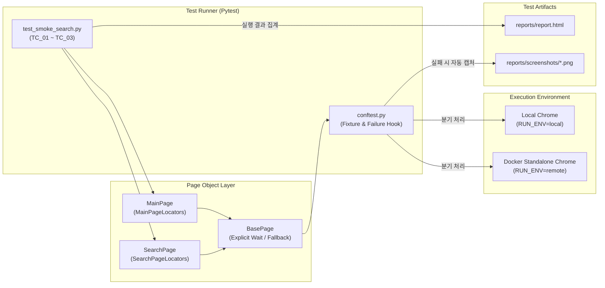

# 🚀 채용 플랫폼(알바몬) 핵심 기능 UI 스모크 테스트 자동화 프로젝트


> **채용 플랫폼 알바몬(Albamon) 웹 서비스의 핵심 사용자 여정(메인 진입 → 키워드 검색 → 채용 공고 상세 조회)을 검증하는 E2E UI 스모크 테스트(Smoke Test) 자동화 프레임워크입니다.**

---

## 1. 📌 프로젝트 추진 배경 (Background & Objective)

### 실무 데일리 배포 수동 검수의 한계 극복 및 회귀 테스트 공수 절감
애자일(Agile) 및 CI/CD 기반의 잦은 배포 환경에서는 매 배포 직후 서비스의 핵심 기능이 정상 동작하는지 확인하는 **스모크 테스트(Smoke Test)**와 **회귀 테스트(Regression Test)**가 필수적입니다. 하지만 이를 매번 QA 엔지니어가 수동으로 수행할 경우 다음과 같은 한계가 발생합니다.

1. **반복적인 수동 검수로 인한 리소스 낭비**: 매일 반복되는 기본 기능(메인 로드, 검색, 상세 페이지 진입) 확인에 시간이 소요되어, 정작 중요한 탐색적 테스팅(Exploratory Testing)이나 엣지 케이스 검증에 집중하기 어렵습니다.
2. **휴먼 에러 및 검증 편차 발생**: 수동 테스트 특성상 담당자의 컨디션이나 환경에 따라 검증 누락이 발생할 수 있습니다.
3. **장애 조기 탐지(Shift-Left) 지연**: 프론트엔드 개편이나 API 변경으로 인한 Critical Path 장애를 배포 직후 즉각적으로 감지하기 어렵습니다.

본 프로젝트는 이러한 실무적 페인 포인트(Pain Point)를 해결하기 위해 **가장 비즈니스 임팩트가 큰 핵심 사용자 시나리오(Critical User Journey)를 코드로 자동화**하여, **배포 후 1분 이내에 서비스 건전성을 검증하고 반복 검수 공수를 획기적으로 절감**하는 것을 목표로 구축되었습니다.

---

## 2. 🏗️ 아키텍처 및 기술적 특징 (Architecture & Key Features)

### ① 유지보수성을 극대화한 Page Object Model (POM) 디자인 패턴 적용
- **비즈니스 로직과 UI 셀렉터의 철저한 분리**: 테스트 시나리오(`tests/`)와 웹 페이지 객체(`pages/`)를 분리하고, 각 페이지 내에서도 `MainPageLocators`, `SearchPageLocators` 클래스로 모든 CSS Selector를 중앙 집중화했습니다.
- **프론트엔드 변경에 유연한 대응**: 상용 웹사이트(알바몬)의 UI 개편이나 A/B 테스트로 인해 DOM 구조가 변경되더라도, 테스트 스크립트 수정 없이 Locator 상수만 업데이트하면 전체 테스트에 즉시 반영됩니다.

### ② Flaky Test(간헐적 실패)를 방지하는 Explicit Wait 전략
- **`time.sleep()` 하드코딩 전면 배제**: 무조건적인 고정 대기 시간으로 인해 테스트 실행 시간이 불필요하게 길어지거나, 네트워크 지연 시 간헐적으로 실패(Flaky)하는 문제를 방지했습니다.
- **`WebDriverWait` & `expected_conditions` 캡슐화**: `BasePage`에서 요소의 가시성(`visibility_of_element_located`), 클릭 가능 여부(`element_to_be_clickable`), 브라우저의 문서 로드 완료 상태(`document.readyState == 'complete'`)를 명시적으로 대기하도록 설계했습니다.
- **안전한 인터랙션 폴백(Fallback) 메커니즘**: 동적 레이어나 애니메이션으로 인해 일반 `click()`이 가로채기(`ElementClickInterceptedException`)를 당할 경우, 자동으로 JavaScript 기반 클릭(`execute_script`)으로 폴백하여 테스트 안정성을 높였습니다.

### ③ Docker Standalone Grid 기반의 일관된 테스트 실행 환경
- **로컬 브라우저 및 드라이버 버전 충돌 해결**: 작업자의 PC마다 설치된 Chrome 버전이 달라 발생하는 `SessionNotCreatedException` 문제를 근본적으로 차단하기 위해 `selenium/standalone-chrome` 컨테이너와 테스트 러너 컨테이너를 `docker-compose.yml`로 연동했습니다.
- **환경변수 기반 Local / Remote WebDriver 유연한 분기**: `conftest.py`에서 `RUN_ENV` 환경변수 하나로 로컬 디버깅 모드(`local`)와 Docker Grid 원격 실행 모드(`remote`)를 코드 변경 없이 전환할 수 있도록 구현했습니다.

### ④ 테스트 실패 시 자동 스크린샷 캡처 및 HTML 리포트 임베딩
- **빠른 디버깅(Root Cause Analysis) 지원**: Pytest의 `pytest_runtest_makereport` 훅(Hook)을 커스텀 구현하여, 테스트가 실패하는 즉시 `reports/screenshots/` 경로에 타임스탬프가 찍힌 화면 스크린샷(`FAIL_<테스트명>_<일시>.png`)을 자동 저장합니다.
- **시각화된 리포트 제공**: `pytest-html`과 연동하여 단일 파일(`--self-contained-html`) 형태의 리포트를 생성하며, 실패 시 캡처된 스크린샷과 실패 시점의 URL이 HTML 리포트 내부에 자동으로 첨부됩니다.



---

## 3. 📂 프로젝트 폴더 구조 (Directory Structure)

```text
albamon-qa-automation/
├── docker-compose.yml       # Selenium Standalone Chrome + 테스트 실행 컨테이너 오케스트레이션
├── Dockerfile               # Python 3.11 기반 테스트 실행 환경 이미지 빌드 설정
├── requirements.txt         # 필수 파이썬 패키지 명세 (selenium, pytest, pytest-html 등)
├── pytest.ini               # Pytest 실행 옵션, 리포트 경로, 로깅 포맷 및 마커 설정
├── README.md                # 프로젝트 아키텍처 및 실행 가이드 문서
├── pages/                   # Page Object Model (POM) 패키지
│   ├── __init__.py
│   ├── base_page.py         # 공통 메서드 (Explicit Wait 기반 탐색, 클릭, 텍스트 입력, 스크린샷 등)
│   ├── main_page.py         # 알바몬 메인 페이지 객체 및 셀렉터 관리 (검색창, 헤더, 팝업 제어)
│   └── search_page.py       # 검색 결과 및 공고 상세 페이지 객체 (공고 리스트 검증, 상세 이동)
├── tests/                   # 테스트 스위트 패키지
│   ├── __init__.py
│   ├── conftest.py          # Local/Remote WebDriver 초기화 Fixture 및 실패 시 자동 스크린샷 Hook
│   └── test_smoke_search.py # 핵심 스모크 테스트 시나리오 3종 구현 (TC_01 ~ TC_03)
└── reports/                 # (실행 시 자동 생성) HTML 리포트 및 실패 스크린샷 저장 디렉토리
    ├── report.html
    └── screenshots/
```

---

## 4. 🧪 핵심 스모크 테스트 시나리오 (Test Scenarios)

| 테스트 ID | 테스트 케이스명 | 검증 목적 및 상세 시나리오 | 기대 결과 (Expected Result) |
| :--- | :--- | :--- | :--- |
| **TC_01** | `test_tc01_main_page_load_verification`<br/>(메인페이지 정상 로드 검증) | 1. 알바몬 메인 페이지(`https://www.albamon.com`) 접속<br/>2. 브라우저 타이틀 및 상단 헤더/검색창 UI 확인 | • 타이틀에 '알바몬'이 포함되어야 함<br/>• 상단 헤더 및 통합 검색창이 화면에 정상 노출됨 |
| **TC_02** | `test_tc02_keyword_search_and_results_verification`<br/>(키워드 검색 및 결과 노출 검증) | 1. 메인 검색창에 `'카페'` 키워드 입력 후 검색 실행<br/>2. 검색 결과 페이지 이동 및 채용 공고 리스트 탐색 | • 검색 결과 페이지로 정상 라우팅됨<br/>• 채용 공고 리스트가 화면에 **1개 이상** 노출됨 |
| **TC_03** | `test_tc03_job_detail_page_navigation_verification`<br/>(공고 상세페이지 진입 검증) | 1. 키워드 검색 결과 리스트에서 첫 번째 채용 공고 클릭<br/>2. 새 탭/현재 탭 전환 처리 후 상세 페이지 로드 확인 | • 클릭한 채용 공고의 상세 페이지 URL로 정상 진입함<br/>• 상세 페이지 본문 헤더 UI가 정상 렌더링됨 |

---

## 5. ⚡ 실행 방법 (How to Run)

### 방법 A. Docker Compose를 이용한 실행 (권장 - 환경 설정 불필요)
로컬 PC에 Python이나 Chrome 브라우저/드라이버가 설치되어 있지 않아도 Docker만 있으면 즉시 동일한 환경에서 테스트를 실행할 수 있습니다.

```bash
# 1. 프로젝트 루트 디렉토리로 이동
cd albamon-qa-automation

# 2. Docker Compose로 Selenium Chrome 노드 구동 및 테스트 실행
docker-compose up --build --abort-on-container-exit

# 3. 실행 완료 후 컨테이너 정리
docker-compose down
```
> 💡 **실시간 브라우저 화면 확인 팁**: `docker-compose up` 실행 중 로컬 브라우저에서 `http://localhost:7900`에 접속하면 Selenium 컨테이너 내부에서 테스트가 수행되는 모습을 실시간(noVNC)으로 모니터링할 수 있습니다.

---

### 방법 B. 로컬 환경(Local Python)에서 직접 실행

#### 1) 가상환경 생성 및 패키지 설치
```bash
cd albamon-qa-automation

# 가상환경 생성 및 활성화 (Windows PowerShell 기준)
python -m venv .venv
.\.venv\Scripts\Activate.ps1

# (macOS / Linux 기준)
# python3 -m venv .venv && source .venv/bin/activate

# 의존성 패키지 설치
pip install -r requirements.txt
```

#### 2) 테스트 실행 명령어
```bash
# 기본 실행 (로컬 Chrome 브라우저 UI 모드로 실행)
pytest

# Headless 모드로 백그라운드에서 빠르게 실행하고 싶을 때 (Windows PowerShell)
$env:HEADLESS="true"; pytest

# 스모크 테스트 마커(@pytest.mark.smoke)만 선택하여 실행
pytest -m smoke
```

---

## 6. 📊 테스트 결과 리포트 및 스크린샷 확인

테스트 실행이 완료되면 프로젝트 루트의 `reports/` 디렉토리에 결과물이 자동으로 생성됩니다.

- **HTML 테스트 리포트**: `reports/report.html` 파일을 웹 브라우저로 열면 전체 테스트 수행 시간, Pass/Fail 통계, 실행 로그를 한눈에 확인할 수 있습니다.
- **실패 자동 스크린샷**: 만약 특정 테스트 케이스가 실패할 경우 `reports/screenshots/FAIL_<테스트함수명>_<YYYYMMDD_HHMMSS>.png` 파일이 생성되며, `report.html` 내부에서도 즉시 이미지를 확인할 수 있습니다.
